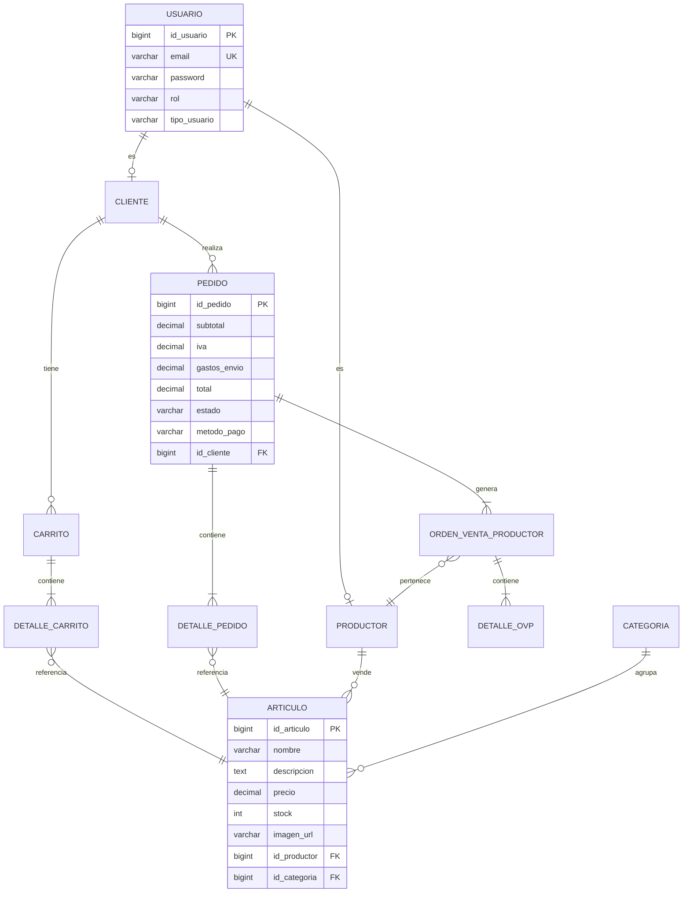

<div align="center">

# 🌾 Cosecha en Cope

### Marketplace B2B2C para productos agrícolas de proximidad

[](https://spring.io/projects/spring-boot)
[](https://angular.io/)
[](https://www.postgresql.org/)
[](https://aws.amazon.com/s3/)
[](https://openjdk.org/)
[](https://www.typescriptlang.org/)

[](https://www.cypress.io/)
[](https://swagger.io/)
[](https://jwt.io/)
[](LICENSE)

<br/>

**Plataforma fullstack que conecta productores agrícolas locales con consumidores y distribuidores,**  
**implementando arquitectura híbrida SSR + SPA para máximo SEO sin sacrificar UX.**

[🚀 Demo](#-demo) • [📖 Documentación](#-arquitectura-técnica) • [⚡ Quick Start](#-instalación-rápida) • [🤝 Contribuir](#-contribuir)

</div>

---

## 📋 Tabla de Contenidos

- [🎯 El Problema que Resuelve](#-el-problema-que-resuelve)
- [✨ Características Principales](#-características-principales)
- [🏗️ Arquitectura Técnica](#️-arquitectura-técnica)
- [🛠️ Stack Tecnológico](#️-stack-tecnológico)
- [📊 Modelo de Datos](#-modelo-de-datos)
- [🔐 Seguridad](#-seguridad)
- [⚡ Instalación Rápida](#-instalación-rápida)
- [📁 Estructura del Proyecto](#-estructura-del-proyecto)
- [🧪 Testing](#-testing)
- [📈 Roadmap](#-roadmap)
- [🤝 Contribuir](#-contribuir)

---

## 🎯 El Problema que Resuelve

<table>
<tr>
<td width="50%">

### 🚫 El Desafío

Los pequeños productores agrícolas enfrentan:

- ❌ **Dependencia de intermediarios** que reducen márgenes
- ❌ **Falta de visibilidad** en mercados digitales
- ❌ **Complejidad técnica** para gestionar ventas online
- ❌ **Dificultad** para llegar tanto a consumidores finales (B2C) como distribuidores (B2B)

</td>
<td width="50%">

### ✅ La Solución

**Cosecha en Cope** ofrece:

- ✅ **Marketplace directo** productor → consumidor/distribuidor
- ✅ **Panel de gestión** intuitivo para productores
- ✅ **Órdenes de venta** automáticas por productor (OVP)
- ✅ **SEO optimizado** para máxima visibilidad
- ✅ **Escalabilidad cloud** con AWS S3

</td>
</tr>
</table>

---

## ✨ Características Principales

<table>
<tr>
<td align="center" width="25%">

<br/><b>Carrito Inteligente</b>
<br/><sub>Persistente con cálculo automático de IVA, gastos de envío y totales por línea</sub>
</td>
<td align="center" width="25%">

<br/><b>Multi-Productor</b>
<br/><sub>Gestión de catálogo independiente por productor con su propio dashboard</sub>
</td>
<td align="center" width="25%">

<br/><b>Órdenes OVP</b>
<br/><sub>Generación automática de órdenes de venta por productor desde pedidos cliente</sub>
</td>
<td align="center" width="25%">

<br/><b>Media en Cloud</b>
<br/><sub>Imágenes en AWS S3 con estructura organizada por productor</sub>
</td>
</tr>
<tr>
<td align="center" width="25%">

<br/><b>Autenticación JWT</b>
<br/><sub>Roles diferenciados: Cliente, Productor, Admin con guards protegidos</sub>
</td>
<td align="center" width="25%">

<br/><b>SEO Híbrido</b>
<br/><sub>Landing pages SSR (Thymeleaf) + App SPA (Angular) para mejor indexación</sub>
</td>
<td align="center" width="25%">

<br/><b>API REST Documentada</b>
<br/><sub>Swagger UI integrado con documentación OpenAPI completa</sub>
</td>
<td align="center" width="25%">

<br/><b>E2E Testing</b>
<br/><sub>Flujos críticos de compra automatizados con Cypress</sub>
</td>
</tr>
</table>

---

## 🏗️ Arquitectura Técnica

### Decisión Clave: Arquitectura Híbrida SSR + SPA

```
┌─────────────────────────────────────────────────────────────────────────────────┐
│                              ARQUITECTURA HÍBRIDA                               │
├─────────────────────────────────────────────────────────────────────────────────┤
│                                                                                 │
│   ┌──────────────────┐         ┌──────────────────────────────────────────┐    │
│   │   LANDING PAGES  │         │           APLICACIÓN SPA                 │    │
│   │   (SSR - SEO)    │         │         (Angular 20)                     │    │
│   ├──────────────────┤         ├──────────────────────────────────────────┤    │
│   │ • /              │         │ • /app/articulos                         │    │
│   │ • /nosotros      │ ──────► │ • /app/carrito                           │    │
│   │ • /contacto      │         │ • /app/checkout                          │    │
│   │ • /categorias    │         │ • /app/productor/dashboard               │    │
│   └────────┬─────────┘         └───────────────────┬──────────────────────┘    │
│            │                                       │                           │
│            │         Thymeleaf Templates           │    Standalone Components  │
│            │                                       │                           │
│            └───────────────────┬───────────────────┘                           │
│                                │                                               │
│                    ┌───────────▼───────────┐                                   │
│                    │     SPRING BOOT 3     │                                   │
│                    │      API REST         │                                   │
│                    ├───────────────────────┤                                   │
│                    │ • Controllers (11)    │                                   │
│                    │ • Services (11)       │                                   │
│                    │ • Security (JWT)      │                                   │
│                    │ • S3 Integration      │                                   │
│                    └───────────┬───────────┘                                   │
│                                │                                               │
│            ┌───────────────────┼───────────────────┐                           │
│            │                   │                   │                           │
│   ┌────────▼────────┐ ┌────────▼────────┐ ┌───────▼───────┐                   │
│   │   PostgreSQL    │ │     AWS S3      │ │   Actuator    │                   │
│   │   (13 tablas)   │ │   (Imágenes)    │ │   (Metrics)   │                   │
│   └─────────────────┘ └─────────────────┘ └───────────────┘                   │
│                                                                                 │
└─────────────────────────────────────────────────────────────────────────────────┘
```

### ¿Por qué Arquitectura Híbrida?

| Aspecto | Solo SPA | Solo SSR | **Híbrida (Elegida)** |
|---------|----------|----------|----------------------|
| **SEO** | ❌ Pobre | ✅ Excelente | ✅ Excelente |
| **UX/Velocidad** | ✅ Fluida | ❌ Recarga páginas | ✅ Fluida |
| **Tiempo de desarrollo** | ✅ Rápido | ⚠️ Medio | ⚠️ Medio |
| **Mantenibilidad** | ✅ Una tech | ⚠️ Una tech | ✅ Separación clara |

> **Resultado:** Landing pages indexables por Google + Aplicación reactiva para usuarios autenticados

---

## 🛠️ Stack Tecnológico

<table>
<tr>
<th>Capa</th>
<th>Tecnología</th>
<th>Versión</th>
<th>Propósito</th>
</tr>
<tr>
<td rowspan="6"><b>🔧 Backend</b></td>
<td> Java</td>
<td>17 LTS</td>
<td>Lenguaje base</td>
</tr>
<tr>
<td> Spring Boot</td>
<td>3.5.2</td>
<td>Framework principal</td>
</tr>
<tr>
<td>🔐 Spring Security</td>
<td>6.x</td>
<td>Autenticación JWT</td>
</tr>
<tr>
<td>📊 Spring Data JPA</td>
<td>3.x</td>
<td>Persistencia ORM</td>
</tr>
<tr>
<td>📄 SpringDoc OpenAPI</td>
<td>2.8.8</td>
<td>Documentación API</td>
</tr>
<tr>
<td>🍃 Thymeleaf</td>
<td>3.x</td>
<td>Templates SSR</td>
</tr>
<tr>
<td rowspan="4"><b>🎨 Frontend</b></td>
<td> Angular</td>
<td>20.3</td>
<td>Framework SPA</td>
</tr>
<tr>
<td> TypeScript</td>
<td>5.9</td>
<td>Tipado estático</td>
</tr>
<tr>
<td> Bootstrap</td>
<td>5.3</td>
<td>UI Components</td>
</tr>
<tr>
<td>🔄 RxJS</td>
<td>7.8</td>
<td>Programación reactiva</td>
</tr>
<tr>
<td rowspan="2"><b>🗄️ Base de Datos</b></td>
<td> PostgreSQL</td>
<td>16+</td>
<td>RDBMS principal</td>
</tr>
<tr>
<td>🔗 Hibernate</td>
<td>6.x</td>
<td>ORM / Migraciones</td>
</tr>
<tr>
<td rowspan="2"><b>☁️ Cloud</b></td>
<td> AWS S3</td>
<td>SDK 2.20</td>
<td>Almacenamiento imágenes</td>
</tr>
<tr>
<td>📊 Spring Actuator</td>
<td>3.x</td>
<td>Health checks & Metrics</td>
</tr>
<tr>
<td rowspan="2"><b>🧪 Testing</b></td>
<td> Cypress</td>
<td>15.7</td>
<td>E2E Testing</td>
</tr>
<tr>
<td>☕ JUnit 5</td>
<td>5.x</td>
<td>Unit Testing</td>
</tr>
</table>

---

## 📊 Modelo de Datos



### Entidades Principales

| Entidad | Descripción | Relaciones Clave |
|---------|-------------|------------------|
| `Usuario` | Autenticación base | → Cliente, Productor |
| `Cliente` | Comprador final | → Carritos, Pedidos |
| `Productor` | Vendedor de productos | → Artículos, OVPs |
| `Articulo` | Producto del catálogo | → Categoría, Productor |
| `Carrito` | Carrito de compra activo | → DetalleCarrito |
| `Pedido` | Orden confirmada | → DetallePedido, OVPs |
| `OrdenVentaProductor` | Orden fragmentada por productor | → DetalleOVP |

---

## 🔐 Seguridad

### Autenticación JWT

```java
// Flujo de autenticación
1. POST /api/auth/login → { email, password }
2. Validación credenciales → UserDetailsService
3. Generación JWT → { token, roles, tipo_usuario }
4. Cliente almacena token → localStorage
5. Requests con header → Authorization: Bearer <token>
```

### Roles y Permisos

| Rol | Acceso | Rutas Protegidas |
|-----|--------|------------------|
| `CLIENTE` | Compras, carrito, pedidos propios | `/app/carrito`, `/app/checkout`, `/app/cliente/**` |
| `PRODUCTOR` | Dashboard, gestión artículos, OVPs | `/app/productor/**` |
| `ADMIN` | Todo el sistema | `/app/admin/**` |

### Guards Angular

```typescript
// Protección de rutas en el frontend
{
  path: 'productor/dashboard',
  canActivate: [authGuard, roleGuard],
  data: { expectedRole: 'PRODUCTOR' }
}
```

---

## ⚡ Instalación Rápida

### Prerrequisitos

```
✅ Java JDK 17+
✅ Node.js 20+ & npm
✅ PostgreSQL 14+
✅ Angular CLI 20+
✅ Cuenta AWS (para S3)
```

### 1️⃣ Clonar el Repositorio

```bash
git clone https://github.com/RafaLopezZz/CosechaEnCope.git
cd CosechaEnCope
```

### 2️⃣ Configurar Base de Datos

```sql
-- Crear base de datos
CREATE DATABASE cosechaencope;

-- Importar esquema (opcional, Hibernate puede generarlo)
psql -d cosechaencope -f docs/database/cosechaencope.sql
```

### 3️⃣ Configurar Backend

```bash
cd backend/cosechaencope

# Crear archivo .env con tus credenciales
cat > .env << EOF
SPRING_DATASOURCE_URL=jdbc:postgresql://localhost:5432/cosechaencope
SPRING_DATASOURCE_USERNAME=tu_usuario
SPRING_DATASOURCE_PASSWORD=tu_password
AWS_ACCESS_KEY_ID=tu_aws_key
AWS_SECRET_ACCESS_KEY=tu_aws_secret
AWS_REGION=eu-west-1
AWS_S3_BUCKET_NAME=tu_bucket
EOF

# Iniciar backend
./mvnw spring-boot:run
```

### 4️⃣ Configurar Frontend

```bash
cd frontend/cosechaencope-frontend

# Instalar dependencias
npm install

# Iniciar en modo desarrollo
ng serve
```

### 5️⃣ Acceder a la Aplicación

| Servicio | URL |
|----------|-----|
| 🌐 Landing (SSR) | http://localhost:8081 |
| 📱 App Angular | http://localhost:4200/app |
| 📚 Swagger UI | http://localhost:8081/swagger-ui.html |
| 📊 Actuator | http://localhost:8081/actuator/health |

---

## 📁 Estructura del Proyecto

```
CosechaEnCope/
├── 📂 backend/cosechaencope/
│   ├── 📂 src/main/java/com/rlp/cosechaencope/
│   │   ├── 📂 config/          # Configuraciones (S3, Security, OpenAPI)
│   │   ├── 📂 controller/      # REST Controllers (11 endpoints)
│   │   │   ├── ArticuloController.java
│   │   │   ├── AuthController.java
│   │   │   ├── CarritoController.java
│   │   │   ├── PedidoController.java
│   │   │   └── ...
│   │   ├── 📂 dto/             # Data Transfer Objects
│   │   ├── 📂 exception/       # Manejo de errores global
│   │   ├── 📂 model/           # Entidades JPA (13 entidades)
│   │   ├── 📂 repository/      # Spring Data Repositories
│   │   ├── 📂 security/        # JWT Utils, Filters, UserDetails
│   │   └── 📂 service/         # Lógica de negocio
│   │       ├── S3FileStorageService.java
│   │       ├── SeoService.java
│   │       └── ...
│   ├── 📂 src/main/resources/
│   │   ├── 📂 templates/       # Thymeleaf (Landing pages SSR)
│   │   │   ├── 📂 pages/       # landing.html, about.html...
│   │   │   ├── 📂 fragments/   # Componentes reutilizables
│   │   │   └── 📂 layout/      # Base templates
│   │   └── application.properties
│   └── pom.xml
│
├── 📂 frontend/cosechaencope-frontend/
│   ├── 📂 src/app/
│   │   ├── 📂 core/            # Servicios singleton, guards, interceptors
│   │   │   ├── 📂 guards/      # authGuard, roleGuard
│   │   │   ├── 📂 interceptors/
│   │   │   └── 📂 services/    # API Services (12 servicios)
│   │   ├── 📂 features/        # Módulos funcionales
│   │   │   ├── 📂 articulos/   # Catálogo de productos
│   │   │   ├── 📂 auth/        # Login/Registro (Cliente + Productor)
│   │   │   ├── 📂 carrito/     # Carrito de compras
│   │   │   ├── 📂 checkout/    # Proceso de pago (4 pasos)
│   │   │   ├── 📂 cliente/     # Panel del cliente
│   │   │   ├── 📂 productor/   # Dashboard productor
│   │   │   │   ├── 📂 articulos/
│   │   │   │   ├── 📂 categorias/
│   │   │   │   ├── 📂 dashboard/
│   │   │   │   ├── 📂 ovp/     # Órdenes de venta
│   │   │   │   └── 📂 perfil/
│   │   │   └── 📂 home/
│   │   └── 📂 shared/          # Componentes y modelos compartidos
│   │       ├── 📂 components/
│   │       └── 📂 models/      # Interfaces TypeScript
│   ├── 📂 cypress/             # Tests E2E
│   │   └── 📂 e2e/
│   │       └── flujo-compra.cy.ts
│   └── package.json
│
├── 📂 docs/
│   ├── 📂 database/
│   │   └── cosechaencope.sql   # Esquema completo
│   └── 📂 comandos/
│
└── README.md
```

---

## 🧪 Testing

### Tests E2E con Cypress

```bash
cd frontend/cosechaencope-frontend

# Abrir Cypress UI
npm run cypress:open

# Ejecutar tests headless
npm run cypress:run
```

#### Flujo de Compra Automatizado

```typescript
// cypress/e2e/flujo-compra.cy.ts
describe('Flujo de Compra E2E', () => {
  it('completa compra desde login hasta confirmación', () => {
    // 1. Login como cliente
    cy.visitApp('/cliente/login');
    cy.get('input#email').type(cliente.email);
    cy.get('input#password').type(cliente.password);
    
    // 2. Añadir productos al carrito
    cy.get('.gallery__item').first().find('.btn-add-cart').click();
    
    // 3. Proceso de checkout (4 pasos)
    cy.visitApp('/checkout');
    // ... verificaciones de cada paso
    
    // 4. Confirmación de pedido
    cy.contains('Pedido confirmado').should('be.visible');
  });
});
```

### Tests Unitarios Backend

```bash
cd backend/cosechaencope
./mvnw test
```

---

## 📈 Roadmap

- [x] 🛒 Carrito de compras con persistencia
- [x] 👤 Sistema de autenticación JWT
- [x] 📦 Gestión de pedidos y OVPs
- [x] ☁️ Integración AWS S3
- [x] 🧪 Tests E2E críticos
- [x] 📚 Documentación API (Swagger)
- [ ] 💳 Integración pasarela de pagos (Stripe)
- [ ] 📱 PWA / App móvil
- [ ] 📊 Dashboard analytics
- [ ] 🌐 Internacionalización (i18n)
- [ ] 🐳 Despliegue con Docker Compose

---

## 🤝 Contribuir

¡Las contribuciones son bienvenidas! Por favor:

1. Fork del repositorio
2. Crea una rama (`git checkout -b feature/nueva-funcionalidad`)
3. Commit de cambios (`git commit -m 'feat: añade nueva funcionalidad'`)
4. Push a la rama (`git push origin feature/nueva-funcionalidad`)
5. Abre un Pull Request

---

## 📄 Licencia

Este proyecto está bajo la Licencia MIT - ver el archivo [LICENSE](LICENSE) para más detalles.

---

<div align="center">

### ⭐ Si este proyecto te resulta útil, ¡dale una estrella!

Desarrollado con ❤️ por [RafaLopezZz](https://github.com/RafaLopezZz)

[](https://github.com/RafaLopezZz)

</div>


